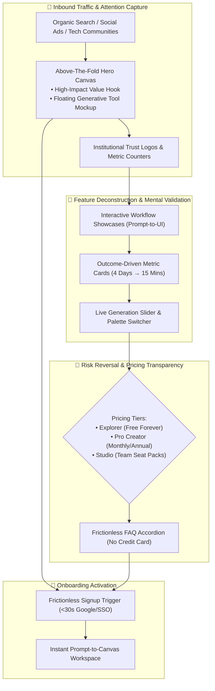
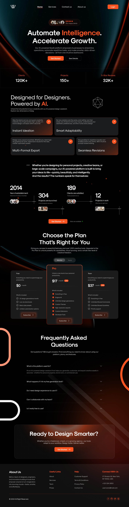

# ⚡ AIDesign — High-Converting AI SaaS Platform Landing Page

### **Conversion-Optimized UI/UX Design, Modern Dark-Theme Architecture & Product Storytelling**

 

Designed by **[Obaidhur Rahaman](https://rahaman1721.framer.website)** · Full Stack Developer & UI/UX Designer  
*Crafting visual narratives that turn curious visitors into paying subscribers for generative AI tools.*

---

## 📌 Case Study Overview

**AIDesign** is a forward-thinking generative AI creative suite designed to automate design workflows, asset generation, and digital canvas prototyping for creators, product teams, and digital agencies.

Landing pages for emerging AI tools frequently suffer from two critical pitfalls:
1. **Abstract buzzwords** without concrete product evidence or visual demonstrations.
2. **Cluttered visual noise** that obscures the core value proposition and call-to-action (CTA).

This case study demonstrates the architecture of a **conversion-first landing page** engineered with high-contrast visual storytelling, clear feature breakdown, and an intuitive user onboarding funnel.

---

## 🏗️ Conversion Architecture & User Ingestion Funnel

AIDesign structures the landing experience around a **psychological trust and mental-validation ladder**, systematically moving prospective users from initial curiosity to high-intent activation.

### 🔬 Conversion Engineering & Growth UX Logic

1. **Cognitive Priming & The 5-Second Test**:
   - The above-the-fold layout pairs an unambiguous value proposition with a high-fidelity visual product snapshot, allowing first-time visitors to grasp the product's primary output in under 5 seconds.
2. **Interactive Proof over Static Promises**:
   - Rather than asking users to trust marketing copy, dynamic sliders and preset prompt chips demonstrate real generative transformations directly inside the browser.
3. **Zero-Commitment Onboarding Ramp**:
   - The primary CTA ("Get Started Free") requires zero credit card input, lowering onboarding resistance while positioning the transparent pricing matrix as an upgrade path once users experience initial value.

---

## 🖼️ High-Fidelity Design Artifact

### Full Landing Page Composition
Designed in Figma with strict 12-column responsive grid alignment, subtle radial ambient glows, cohesive glassmorphic card elevations, and frictionless conversion trigger points.

---

## 🎯 Conversion UX & Structural Breakdown

### 1. The Above-The-Fold Hook (Hero Section)
- **High-Impact Headline**: Clear value promise ("Generate Production-Ready Designs in Seconds, Not Hours").
- **Dual CTA Architecture**: Primary action ("Get Started Free — No Credit Card") paired with low-commitment secondary action ("Watch 90s Interactive Demo").
- **Social Proof Strip**: Trusted logos from tech innovators and creator networks building instant authority.
- **Dynamic Product Preview**: High-fidelity hero mockup displaying generative canvas controls and real-time generation sliders.

### 2. Feature Deconstruction & Use Case Scenarios
- **Feature Cards with Semantic Hierarchy**: Grouped by creator workflows (Prompt-to-UI, Vector Art Generation, Dynamic Brand Kit Harmonization).
- **Interactive Benefit Statements**: Moving beyond technical features to user benefits (e.g., "Reduce iteration cycle from 4 days to 15 minutes").

### 3. Visual Performance & Ambient Dark Mode Aesthetics
- **Deep Space Palette (`#0B0C10`, `#1F2833`)**: Reduces visual fatigue and creates high contrast against vibrant neon accents.
- **Neon Glow Accents (`#6366F1`, `#EC4899`, `#14B8A6`)**: Guides the user's eye towards primary interactive buttons, value tags, and conversion hotspots.
- **Micro-Delight Accents**: Floating badges, pill-shaped category chips, and live generation metrics to convey technological sophistication.

### 4. Risk Reversal & Frictionless Footer Funnel
- **Transparent Tier Previews**: Clear distinction between Free Explorer, Pro Creator, and Enterprise Agency plans.
- **Persistent Sticky Conversion Points**: Accessible navigation header and closing hero footer ensuring users are never more than one click away from the signup funnel.

---

## 📐 Design System Tokens

| Category | Token / Specification | Usage & Rationale |
|:---|:---|:---|
| **Background Dark** | `#08090D` / `#0F1117` | Premium OLED dark background maximizing contrast for rich media. |
| **Primary Accent** | Electric Indigo (`#6366F1`) | Guides primary interactive buttons and key navigational states. |
| **Generative Gradient** | Pink to Cyan (`#EC4899` → `#06B6D4`) | Symbolizes AI innovation, machine learning flow, and creative power. |
| **Typography** | Inter & Display Sans-Serif | Clean geometric proportions with exceptional readability at all screen densities. |
| **Grid System** | 12-Column Responsive (1200px Max-Width) | Ensures consistent rhythm and seamless translation from desktop to mobile. |

---

## 🚀 Impact & Deliverables

- **Deliverables**: High-resolution Figma design composition, vector icon suite, layout specifications, and responsive design tokens ready for React / Next.js / Tailwind CSS frontend implementation.
- **Target Audience**: Generative AI Startups, SaaS Founders, Product Designers, and Growth Marketing Teams.

---
---

## 👨‍💻 Author

**Obaidhur Rahaman**  
Full Stack Developer & Lead UI/UX Designer  

- 🌐 **Portfolio**: [https://rahaman1721.framer.website](https://rahaman1721.framer.website)  
- 🐙 **GitHub**: [@rahaman1721](https://github.com/rahaman1721)  
- 💼 **LinkedIn**: [linkedin.com/in/obaidhur-rahaman-1721z](https://www.linkedin.com/in/obaidhur-rahaman-1721z)  
- 📧 **Email**: [rahaman171920@gmail.com](mailto:rahaman171920@gmail.com)  

  Designed & Developed with precision by Obaidhur Rahaman © 2026

